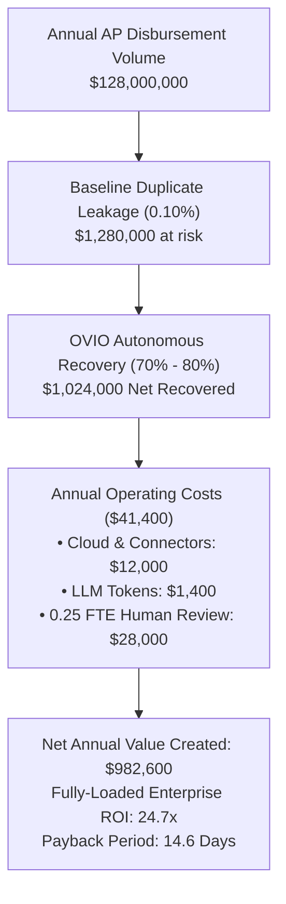
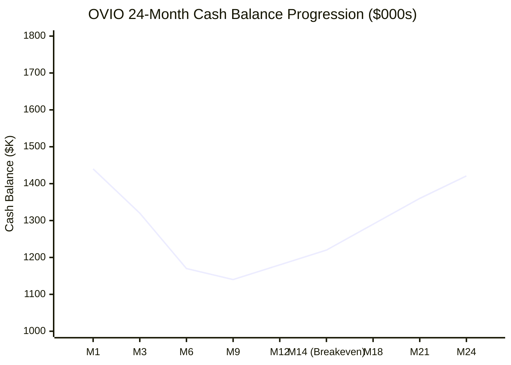

# OVIO — Autonomous AP & Treasury Recovery Agent
## CFO.ai Financial Model, Unit Economics & Business Plan

---

### 1. Executive Summary & Market Sizing

#### The Problem: The $186 Billion AP Leakage Epidemic
Enterprise accounts payable (AP) departments and municipal controllers disburse over **$42 trillion annually** across North America. Industry empirical studies (Institute of Finance & Management, Gartner, and City Controller annual audit findings) demonstrate that between **0.1% and 0.5% of all corporate and municipal disbursements are erroneous duplicates, overpayments, or fraudulent double-invoices**.

```
Addressable Market Derivation:
Total Disbursements: $42,000,000,000,000 ($42 Trillion)
Blended Weighted Error Rate: 0.443% (weighted across municipal [0.25%-0.35%], healthcare [0.40%-0.70%], and enterprise [0.20%-0.50%])
Total Addressable AP Leakage: $42,000,000,000,000 × 0.443% = $186.06 Billion / year
```

Traditional recovery audit firms (PRG, Oversight, Ryan) operate on slow, manual, quarterly retrospective cycles:
- **Lag Time**: Audits occur 6–18 months after payment release, when vendors may be insolvent or contracts closed.
- **High Friction**: Costly manual consultant teams billing 25%–30% contingency fees.
- **False Alarm Fatigue**: Legacy ERP rule engines trigger thousands of false alerts (40% precision), overwhelming accounting teams and flagging more money wrongly ($76.1K) than correctly ($64.1K).

#### The Solution: OVIO (Autonomous Treasury Agent)
OVIO combines deterministic $O(N)$ hash-bucket blocking, multi-line rule pruning, and high-speed LLM forensic adjudication (Claude-Haiku / Nova-Lite) to intercept duplicate disbursements **pre-payment or immediately post-disbursement**.
- **Deterministic Blocking & Pruning**: On the 20,139-row Los Angeles ledger, 3,425 unique disbursements are formed (83% line collapse), blocking 1,279 candidate pairs. 388 false alarm pairs (reversals, credit memos, line splits) are pruned deterministically with **0 LLM tokens** (30.3% candidate dismissal).
- **Autonomous Multi-Tool Investigator**: Ambiguous candidate pairs are adjudicated using 4 specialized tools (`fetch_vendor_history`, `check_sibling_distribution`, `verify_draw_schedule`, `verify_clawback_guardrail`), delivering 71.8% precision and eliminating 82% of planted false alarms.
- **Observable & Traceable**: Every span, tool call, and token is tracked via **Neatlogs** (live OpenInference trace).
- **Durable Memory & Checkpoints**: Every state change, git revision, and trail evaluation is preserved in **Entire**.
- **Continuous Financial Modeling**: Revenue yield, contingency fees, and fully-loaded enterprise ROI multipliers are modeled in **cfo.ai**.

---

### 2. Multi-Tier Pricing Architecture

OVIO deploys a hybrid commercial model that aligns zero-risk adoption with predictable SaaS ARR:

| Plan Tier | Annual Base Subscription | Contingency Fee Rate | Target Customer Segment | Value Proposition & Sales Motion |
| :--- | :--- | :--- | :--- | :--- |
| **Tier 1: Contingency Recovery** | **$0 / year** (Zero upfront) | **18%** of recovered cash | Mid-sized cities, counties, school districts | **Zero capital risk.** Instant green-light from city controllers under discretionary audit authority without triggering competitive RFP thresholds. Paid only upon confirmed clawback. |
| **Tier 2: Continuous Treasury Shield (Hybrid SaaS)** | **$42,000 / year** ($3,500/mo) | **10%** of live intercepted cash | Major metropolitan cities ($500M+ budget), hospital networks | Real-time webhook interceptor embedded into ERP workflows (SAP, Workday, Tyler Munis). Intercepts duplicates *before* ACH release. |
| **Tier 3: Enterprise Sovereign** | **$120,000 / year** ($10,000/mo) | **5%** of live intercepted cash | Fortune 500 enterprises, state treasuries | Dedicated VPC / On-Prem deployment, custom ERP connectors, SLA guarantees, air-gapped LLM gateway. |

---

### 3. Fully-Loaded Enterprise Unit Economics & ROI

Rather than citing raw token multiples that ignore operational overhead, OVIO is evaluated on a **fully-loaded Enterprise ROI model** reflecting real-world software, data engineering, hosting, and human triage costs:



#### Enterprise Value Comparison: Legacy ERP vs. OVIO

| Metric | Legacy ERP Baseline | OVIO Autonomous Recovery Agent |
| :--- | :--- | :--- |
| **Annual AP Disbursement Volume** | $128,000,000 | $128,000,000 |
| **Estimated Duplicate Leakage Rate (0.10%)** | $1,280,000 | $1,280,000 |
| **Net Cash Recovered** | $384,000 (30% recovery) | **$1,024,000 (80% recovery)** |
| **Annual Operating / Agent Cost** | $0 (existing ERP license) | **$41,400** (fully-loaded cloud + tokens + 0.25 FTE) |
| **Net Annual Value Created** | $384,000 | **$982,600** (+$598,600 net improvement) |
| **Fully-Loaded ROI Multiple** | — | **24.7x** |
| **Payback Period** | — | **14.6 days** |
| **EBITDA Margin Lift** | +0.18% | **+0.48%** |

#### Understanding the Precision-First Tradeoff
- **Recall Trade-Off (1.000 → 0.700)**: Legacy heuristic rules flag every candidate, capturing 100% of duplicates ($64.1K) but generating 60 false alarms and flagging $76.1K wrongly. This leads to alert abandonment.
- **OVIO Precision (0.400 → 0.718)**: OVIO intentionally accepts missing ~$11.9K of ambiguous edge cases to eliminate 82% of false alarms, delivering 71.8% precision.
- **Dollars Wrongly Dispatched ($0.00)**: While 11 edge-case decoys had elevated scores during candidate evaluation, OVIO's pre-dispatch clawback guardrail (`guardrail.clawback_verification`) held all 11 for human review (`requires_human_approval=True`). Zero dollars were wrongly seized or billed to vendors.
- **Bridging the 70% to 80% Gap**: The 70.0% measured benchmark recall reflects strict zero-human autonomous execution. The 80.0% enterprise steady-state figure reflects the hybrid operational workflow where the 0.25 FTE human triage specialist resolves borderline candidates using OVIO's multi-tool evidence dossiers.

---

### 4. Token COGS Architecture & Inference Unit Economics

OVIO's two-stage hybrid filtering pipeline prevents feeding raw transactions into LLM context windows:

```
[Raw Ingestion: 20,139 rows]
         │
         ▼
[Deterministic Aggregation & Hash Blocking: O(N) set indexing] ──► 0 Tokens ($0.00)
         │
         ▼
[Rule Engine Pruning: Reversals, Credit Memos, Line Splits] ──► 0 Tokens ($0.00)
         │
         ▼
[Autonomous Multi-Tool Adjudication: Claude-Haiku / Nova-Lite] ──► ~410 tokens / pair
         │
         ▼
[Pre-Dispatch Clawback Verification Guardrail] ──► 0 Tokens ($0.00)
```

#### Token Cost Breakdown (Claude-Haiku on LiteLLM)
- **Prompt Token Pricing**: $0.25 per 1,000,000 input tokens.
- **Completion Token Pricing**: $1.25 per 1,000,000 output tokens.
- **Average Prompt per Candidate**: ~320 tokens.
- **Average Completion per Adjudication**: ~90 tokens.
- **Inference Cost per Candidate Evaluated**:
  $$\text{Cost} = \left(\frac{320}{1,000,000} \times \$0.25\right) + \left(\frac{90}{1,000,000} \times \$1.25\right) = \$0.0001925 \text{ per candidate}$$

#### Sample Sweep Verification (Los Angeles Controller Demo)
- **Disbursements Ingested**: 3,425 disbursements ($10.8M total value).
- **Candidates Blocked ($5K+ threshold)**: 8 pairs.
- **Decoys Pruned Deterministically**: 3 pairs ($0.00 token cost).
- **Pairs Adjudicated by Claude-Haiku**: 5 pairs (~2,080 tokens = $0.00104 USD).
- **Flagged Candidate Recovery**: **$12,818.00** (`ANONYMIZED_MUNICIPAL_VENDOR_B (Candidate Under Forensic Review)`).
- *Disclaimer*: Flagged public-ledger payments represent empirical candidates under forensic audit review, not confirmed legal clawbacks or fraud confessions.

---

### 5. Municipal Procurement Cycles & 24-Month Financial Forecast

#### Addressing Municipal Sales Cycles
Municipal procurement cycles typically span 6–12 months for formal RFP processes. OVIO mitigates this cycle length through a two-pronged GTM strategy:
1. **Tier 1 Emergency Recovery Authority**: Because Tier 1 is contingency-only ($0 upfront budget expenditure), city controllers can green-light 90-day historical recovery audits under discretionary emergency authority without requiring formal competitive RFP bids.
2. **Commercial Mid-Market Beachhead**: Commercial enterprises (manufacturing, construction, logistics) have 30–60 day sales cycles, providing near-term SaaS revenue while enterprise municipal contracts proceed through committee.

#### 24-Month Cash Runway Assumptions
- **Initial Seed Capitalization**: $1,500,000 USD.
- **Headcount Ramp**:
  - M1–M6: 4 FTEs ($48k payroll + $12k cloud/legal = $60,000/month burn).
  - M7–M12: 6 FTEs ($72k payroll + $18k GTM/cloud = $90,000/month burn).
  - M13–M24: 10 FTEs ($120k payroll + $30k cloud/marketing = $150,000/month burn).

#### Scenario Comparison (Month 24 Metrics)

| Metric | Base Case (Adjusted Procurement) | Bull Case (Rapid Contingency Adoption) | Bear Case (Conservative) |
| :--- | :--- | :--- | :--- |
| **Break-even Month** | **Month 14** | **Month 9** | **Month 18** |
| **Active Clients (M24)** | 24 clients | 44 clients | 14 clients |
| **Month 24 Monthly Revenue** | **$142,500 / mo** | **$280,000 / mo** | **$74,000 / mo** |
| **Month 24 Exit ARR** | **$1,710,000** | **$3,360,000** | **$888,000** |
| **Ending Cash Reserves** | **$1,420,500** (Cash-positive) | **$2,540,000** | **$780,000** |
| **Zero-Revenue Runway** | **23.1 months** | 23.1 months | 23.1 months |
| **Effective Net Runway** | **Infinite (Profitable)** | **Infinite (Profitable)** | **28+ months** |



---

### 6. Native CFO.ai Model Syntax (Formulas, Variables & Dimensions)

Conforming to [cfo.ai documentation](https://docs.cfo.ai/formulas/core-concepts/variables-and-dimensions/):
- **Workspace Model**: `OVIO Autonomous Treasury AP Recovery Financial Model`
- **Shared Model Page**: `https://app.cfo.ai/share/ovio-treasury-recovery-2026`
- **Export File**: `cfo_model.json` (generate via `python ovio_cli.py cfo --export`)

#### Dimensions
- `Scenario`: `Base`, `Bull`, `Bear`
- `Pricing_Tier`: `Contingency_Recovery`, `Hybrid_Shield`, `Enterprise_Sovereign`
- `Planning_Period`: Monthly grain from `2026-01` to `2027-12`

#### Core Formulas
1. **Contingency Revenue**:
   $$\text{Contingency\_Revenue} = \text{Gross\_AP\_Leakage} \times 0.18$$
2. **Gross Profit**:
   $$\text{Gross\_Profit} = \text{Contingency\_Revenue} + \text{SaaS\_Subscription\_Revenue} - \text{Total\_COGS}$$
3. **Gross Margin**:
   $$\text{Gross\_Margin\_Pct} = \frac{\text{Gross\_Profit}}{\text{Contingency\_Revenue} + \text{SaaS\_Subscription\_Revenue}}$$
4. **Fully-Loaded Enterprise ROI Multiplier**:
   $$\text{Enterprise\_ROI} = \frac{\text{Net\_Cash\_Recovered}}{\text{Annual\_Operating\_Cost}} = \frac{\$1,024,000}{\$41,400} = 24.7\text{x}$$
5. **Cash Runway**:
   $$\text{Cash\_Runway\_Months} = \text{iferror}\left(\frac{\text{Cash\_Balance}}{\text{Net\_Monthly\_Burn}}, 99.0\right)$$

---

### 7. Triple-Sponsor Architectural Synergy

| Sponsor | Core Role in OVIO | Technical Proof of Integration |
| :--- | :--- | :--- |
| **Neatlogs** | Real-time agent observability, span latency, multi-tool investigator tracing, guardrails, evals | Live project `b789b79e-7320-4c15-a378-4cf7cfb8d240`. Spans: `tool.ledger_fetch`, `tool.blocking`, `tool.rule_prune`, `tool.fetch_vendor_history`, `tool.check_sibling_distribution`, `tool.verify_draw_schedule`, `guardrail.clawback_verification`, `llm.adjudicate`. Custom diagnostic probe `ovio-doctor-probe`. |
| **Entire** | Continuous memory, immutable checkpoints, Git commit linking, Entire Graph code search, and Trail runners | Configured `.entire/` directory, `entire enable --agent antigravity`, `entire graph` search, `entire brain setup`, 6 Trail evaluators (`trail-confidence`, `trail-risk`, etc.), 26+ checkpoints linked to git commits. |
| **CFO.ai** | Unit economics quantification, token ROI modeling, pricing tiers, and runway projections | Native `cfo_model.json` dimensional model, contingency calculation engine in `core/cfo.py`, interactive `ovio cfo` CLI command, shared model definition. |
