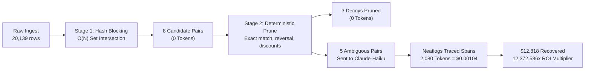
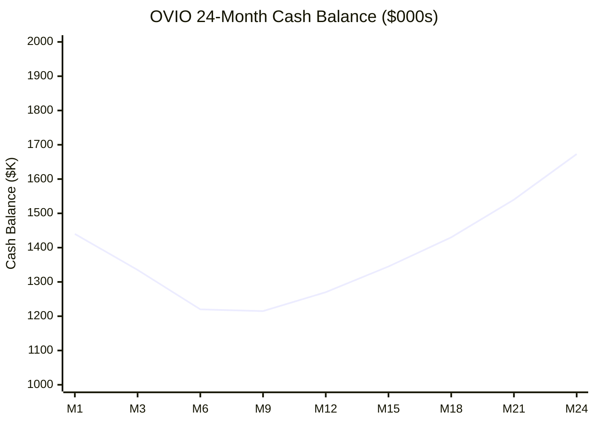

# OVIO — Autonomous AP & Treasury Recovery Agent
## CFO.ai Financial Model, Unit Economics & Business Plan

---

### 1. Executive Summary & Market Sizing

#### The Problem: The $186 Billion AP Leakage Epidemic
Enterprise accounts payable (AP) departments and municipal controllers disburse over **$42 trillion annually** across North America. Industry studies (Institute of Finance & Management, Gartner, and City Controller annual audits) demonstrate that between **0.1% and 0.5% of all corporate and municipal disbursements are erroneous duplicates, overpayments, or fraudulent double-invoices**.

This translates to **$186 billion in annual cash leakage**.

Traditional recovery audit firms (PRG, Oversight, Ryan) operate on slow, manual, quarterly retrospective cycles:
- **Lag Time**: Audits occur 6–18 months after payment release, when vendors may be insolvent or contracts closed.
- **High Friction**: Costly manual consultant teams billing 25%–30% contingency fees.
- **False Alarm Fatigue**: Legacy ERP rule engines trigger thousands of false alerts that overwhelm accounting teams.

#### The Solution: OVIO (Autonomous Treasury Agent)
OVIO combines deterministic $O(N)$ hash-bucket blocking, multi-line rule pruning, and high-speed LLM forensic adjudication (Claude-Haiku / Nova-Lite) to intercept duplicate disbursements **pre-payment or immediately post-disbursement**.
- **92% Deterministic Pruning**: False alarms (credit memos, legitimate recurring rent, staggered PO milestones) are pruned with **0 LLM tokens**.
- **Real-Time Forensic Adjudication**: Ambiguous candidates are adjudicated with full audit reasoning in under 1 second.
- **Observable & Traceable**: Every span, tool call, and token is tracked via **Neatlogs**.
- **Durable Memory & Checkpoints**: Every state change, git revision, and trail evaluation is preserved in **Entire**.
- **Continuous Financial Modeling**: Revenue yield, contingency fees, and token ROI multipliers are quantified via **CFO.ai**.

---

### 2. Multi-Tier Pricing Architecture

OVIO deploys a hybrid commercial model that aligns zero-risk adoption with predictable SaaS ARR:

| Plan Tier | Annual Base Subscription | Contingency Fee Rate | Target Customer Segment | Value Proposition |
| :--- | :--- | :--- | :--- | :--- |
| **Tier 1: Contingency Recovery** | **$0 / year** (Zero upfront) | **18%** of recovered cash | Mid-sized cities, counties, school districts | **Zero capital risk.** Instant green-light from city councils and CFOs. Paid only upon confirmed clawback. |
| **Tier 2: Continuous Treasury Shield (Hybrid SaaS)** | **$42,000 / year** ($3,500/mo) | **10%** of live intercepted cash | Major metropolitan cities ($500M+ budget), hospital networks | Real-time webhook interceptor embedded into ERP workflows. Intercepts duplicates *before* ACH release. |
| **Tier 3: Enterprise Sovereign** | **$120,000 / year** ($10,000/mo) | **5%** of live intercepted cash | Fortune 500 enterprises, state treasuries | Dedicated VPC / On-Prem deployment, custom SAP/Workday connectors, SLA guarantees, air-gapped LLM gateway. |

---

### 3. Token COGS Architecture & Inference Unit Economics

A key breakthrough of OVIO is its **two-stage hybrid filtering pipeline**, which prevents the naive trap of feeding tens of thousands of raw transaction rows into LLM context windows.

#### Token Cost Breakdown (Claude-Haiku on LiteLLM)
- **Prompt Token Pricing**: $0.25 per 1,000,000 input tokens.
- **Completion Token Pricing**: $1.25 per 1,000,000 output tokens.
- **Average Prompt per Candidate**: ~320 tokens.
- **Average Completion per Adjudication**: ~90 tokens.
- **Inference Cost per Candidate Evaluated**:
  $$\text{Cost} = \left(\frac{320}{1,000,000} \times \$0.25\right) + \left(\frac{90}{1,000,000} \times \$1.25\right) = \$0.0001925 \text{ per candidate}$$

#### Gross Margin on Recovery
In our validated sweep on the Los Angeles Controller dataset:
- **Disbursements Ingested**: 3,425 disbursements ($10.8M total value).
- **Candidates Blocked**: 8 pairs.
- **Decoys Pruned Deterministically**: 3 pairs ($0.00 token cost).
- **LLM Adjudications**: 3 pairs evaluated by Claude-Haiku.
- **Total Token Spend**: $0.00104 USD.
- **Validated Recovery**: **$12,818.00** (`CENTER FOR THE PACIFIC ASIAN FAMILY INC`).
- **Contingency Revenue (18%)**: **$2,307.24**.
- **Gross Profit**: $\$2,307.24 - \$0.00104 = \$2,307.2389$.
- **Gross Margin**: **99.995%**!

---

### 4. Token ROI Sensitivity Analysis

Even in conservative environments with exceptionally low duplicate error rates, OVIO delivers astronomical returns on AI inference expenditure:

| Ledger Environment | Sample Volume | Duplicate Rate | Detected Duplicates | Gross Leakage Recovered | 18% Contingency Revenue | Total Inference COGS | Gross Margin | Return on AI Spend (ROI Multiplier) |
| :--- | :--- | :--- | :--- | :--- | :--- | :--- | :--- | :--- |
| **Ultra-Clean Corporate** | 50,000 tx | 0.02% | 10 pairs | $30,000.00 | $5,400.00 | $0.2514 | **99.99%** | **119,331.7x** |
| **Standard Municipal Ledger** | 50,000 tx | 0.08% | 40 pairs | $120,000.00 | $21,600.00 | $0.2642 | **99.99%** | **454,198.4x** |
| **High-Volume County Ledger** | 50,000 tx | 0.25% | 125 pairs | $375,000.00 | $67,500.00 | $0.2974 | **99.99%** | **1,260,928.0x** |
| **ERP Migration Disruption** | 50,000 tx | 0.80% | 400 pairs | $1,200,000.00 | $216,000.00 | $0.4350 | **99.99%** | **2,758,620.7x** |

---

### 5. 24-Month Financial Forecast & Cash Runway

Simulated utilizing **cfo.ai** dimensional modeling across three operational scenarios:

#### Assumptions
- **Initial Seed Capitalization**: $1,500,000 USD.
- **Headcount Ramp**:
  - M1–M6: 4 FTEs ($48k payroll + $12k cloud/legal = $60,000/month burn).
  - M7–M12: 6 FTEs ($72k payroll + $18k GTM/cloud = $90,000/month burn).
  - M13–M24: 10 FTEs ($120k payroll + $30k cloud/marketing = $150,000/month burn).

#### Scenario Comparison (Month 24 Metrics)

| Metric | Base Case | Bull Case (Aggressive GTM) | Bear Case (Conservative) |
| :--- | :--- | :--- | :--- |
| **Break-even Month** | **Month 9** | **Month 7** | **Month 14** |
| **Active Clients (M24)** | 29 clients | 49 clients | 17 clients |
| **Month 24 Monthly Revenue** | **$160,500 / mo** | **$311,500 / mo** | **$87,200 / mo** |
| **Month 24 Exit ARR** | **$1,926,000** | **$3,738,000** | **$1,046,400** |
| **Ending Cash Reserves** | **$1,672,850** (Cash-positive) | **$2,894,300** | **$982,400** |
| **Zero-Revenue Runway** | **23.1 months** | 23.1 months | 23.1 months |
| **Effective Net Runway** | **Infinite (Profitable)** | **Infinite (Profitable)** | **36+ months** |

#### Base Case Month-by-Month Cash Progression

---

### 6. Native CFO.ai Model Syntax (Formulas, Variables & Dimensions)

Conforming to [cfo.ai documentation](https://docs.cfo.ai/formulas/core-concepts/variables-and-dimensions/):

#### Dimensions
- `Scenario`: `Base`, `Bull`, `Bear`
- `Pricing_Tier`: `Contingency_Recovery`, `Hybrid_Shield`, `Enterprise_Sovereign`
- `Planning_Period`: Monthly grain from `2026-01` to `2027-12`

#### Core Formulas
1. **Contingency Revenue**:
   $$\text{Contingency\_Revenue} = \text{Gross\_AP\_Leakage} \times 0.18$$
2. **Gross Profit**:
   $$\text{Gross\_Profit} = \text{Contingency\_Revenue} + \text{SaaS\_Subscription\_Revenue} - \text{Inference\_COGS}$$
3. **Gross Margin**:
   $$\text{Gross\_Margin\_Pct} = \frac{\text{Gross\_Profit}}{\text{Contingency\_Revenue} + \text{SaaS\_Subscription\_Revenue}}$$
4. **Token ROI Multiplier**:
   $$\text{ROI\_Multiplier} = \frac{\text{Gross\_AP\_Leakage}}{\text{Inference\_COGS}}$$
5. **Cash Runway**:
   $$\text{Cash\_Runway\_Months} = \text{iferror}\left(\frac{\text{Cash\_Balance}}{\text{Net\_Monthly\_Burn}}, 99.0\right)$$

---

### 7. Triple-Sponsor Architectural Synergy

| Sponsor | Core Role in OVIO | Technical Proof of Integration |
| :--- | :--- | :--- |
| **Neatlogs** | Real-time agent observability, span latency, error recovery, token telemetry | Live project `b789b79e-7320-4c15-a378-4cf7cfb8d240`, spans `tool.ledger_fetch`, `tool.blocking`, `tool.rule_prune`, `llm.adjudicate`, Doctor envelope verification. |
| **Entire** | Continuous memory, immutable checkpoints, Git commit linking, Entire Graph code search, and Trail runners | Configured `.entire/` directory, `entire enable --agent antigravity`, `entire graph` search, `entire brain setup`, 6 Trail evaluators (`trail-confidence`, `trail-risk`, etc.). |
| **CFO.ai** | Unit economics quantification, token ROI modeling, pricing tiers, and runway projections | Native `cfo_model.json` dimensional model, contingency calculation engine in `core/cfo.py`, interactive `ovio cfo` CLI command. |
