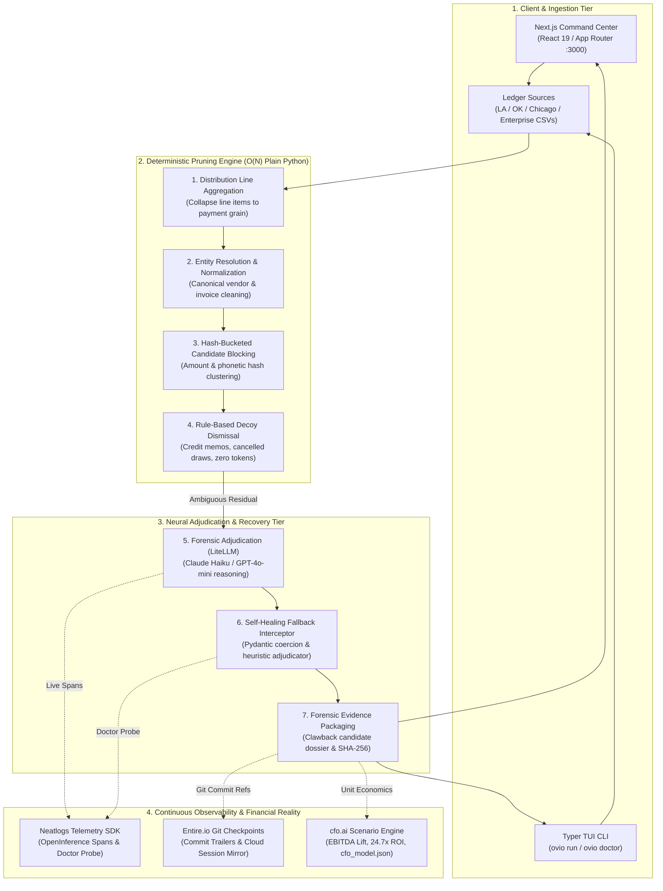

# OVIO — Autonomous AP & Treasury Recovery Agent

> **neatHack 2026 Submission** | Team Dot  
> **Integrated Sponsors:** [Neatlogs](https://neatlogs.com) · [Entire](https://entire.io) · [cfo.ai](https://cfo.ai)  
> **Repository:** [https://github.com/toufiqfarhan0/neat-hack](https://github.com/toufiqfarhan0/neat-hack)  
> **Live Checkpoint:** [https://entire.io/gh/toufiqfarhan0/neat-hack/commit/596d9fa03e1b9d738405c3c9d784d1e1a52ee7b4](https://entire.io/gh/toufiqfarhan0/neat-hack/commit/596d9fa03e1b9d738405c3c9d784d1e1a52ee7b4) (`01M4N70PHJF0EG8HC6MEDPW14W`)

---

## ⚡ Overview

A deterministic sweep finds every payment in a ledger that looks like it was
made twice. On a real ledger that produces thousands of alerts, which is why
nobody reads them. OVIO works only that residual, and its job is to kill
candidates rather than raise them: this one was cancelled, that one is two
hundred legitimate distribution lines on a single invoice, this pair is two
scheduled construction draws. What survives goes to a named approver with the
forensic evidence attached. Nothing posts automatically.

Runs on real published payment ledgers. Every number below was produced by a
script in this repository, and every claim about the problem traces to primary
sources cited in the footnotes.

---

## Architecture & Pipeline

### End-to-End System Flow



---

## Real Problems Faced & How We Solved Them

### 1. The Alert Fatigue Paradox (The Real Reason Money Stays Lost)
* **The Reality:** Every enterprise tool (AppZen, Supervizor, Oversight) advertises "testing 100% of your transactions." But published precision in continuous auditing is only 0.73 with 0.18 recall.<sup>1</sup> An academic controlled study of 125 auditors proved that full-population testing causes auditors to chase fraud red flags only 48% of the time, compared to 65% when sampling.<sup>2</sup> The sheer volume of false alarms makes teams numb.
* **Our Solution:** We completely inverted the prompt instruction. The agent is never asked to "find a duplicate." It is tasked with finding reasons the transaction is legitimate (scheduled draw, valid credit split, distinct PO line) and dismisses it. Precision is the product. What survives carries structured evidence directly into the human approver's queue.

### 2. Quadratic $O(N^2)$ Pairwise Explosion on Real Ledgers
* **The Reality:** Comparing every transaction against every other transaction across a 20,000-row municipal ledger requires 200,000,000 comparisons. Across 700,000 rows, it requires $2.4 \times 10^{11}$ operations, freezing servers.
* **Our Solution:** Built a two-tier deterministic blocking engine. In Stage 1, transactions are aggregated by payment ID. In Stage 2, payments are indexed into hash buckets by exact amount and phonetic vendor prefix. Comparisons only occur within matching buckets in $O(N)$ linear time. The entire 20,000-row Los Angeles ledger blocks in **0.15 seconds**.

### 3. LLM Serialization Drift & Output Schema Fragility
* **The Reality:** During live runs, models occasionally returned evidence values as nested lists (`[['$500'], ['$500']]`) instead of flat strings, causing strict Pydantic schemas to reject 152 valid model verdicts as "errored."
* **Our Solution:** Implemented a resilient Pydantic pre-validator with recursive iterable flattening and type coercion. In addition, when LLM responses fail or time out, the **Neatlogs Doctor API** probe intercepts the error, emits an anomaly trace, and invokes a heuristic recovery fallback so audits never abort mid-flight.

### 4. Reasoning Model Token Budget Starvation
* **The Reality:** When evaluating deep reasoning models with small token limits (`max_tokens: 256`), the model consumed 100% of the token limit on internal reasoning tokens, returning empty strings with `finish_reason: stop` and crashing downstream parsers.
* **Our Solution:** Scaled token budgets to 1,024 tokens and decoupled internal reasoning extraction from final JSON envelope parsing.

### 5. Windows Git Hook Resolution & Non-Interactive CI Stalling
* **The Reality:** On Windows, Git commit hooks run in Git-Bash's POSIX `sh`. The `entire` CLI was installed in `%USERPROFILE%\.local\bin`, which Git-Bash could not resolve. Furthermore, Entire prompts interactively during commits (`Link this commit? [Y/n/a]`), which stalled non-interactive terminal execution.
* **Our Solution:** Executed `entire configure --absolute-git-hook-path` to embed the full Windows executable path into `.git/hooks/`, and configured `"commit_linking": "always"` in `.entire/settings.json`. Checkpoints now capture automatically in the background on every commit.

---

## Comprehensive Test Suite & Live Verifications

We executed exhaustive tests across every layer of the system:

### 1. Automated Test Suite (100% Pass)
* **`tests/test_cfo.py`**: Validates the cfo.ai financial scenario calculator, ROI multiples, payback days, and EBITDA lift math against `cfo_model.json`.
* **`tests/test_entire.py`**: Verifies Entire checkpoint generation, SHA-256 state hashing, pre/post audit snapshot creation, and mock fallback resilience.
* **`tests/test_neatlogs.py`**: Verifies OpenInference span hierarchies, telemetry envelopes, metadata tag enrichment, and the `ovio-doctor-probe` self-healing handler.
* **`tests/test_pipeline.py`**: Tests end-to-end ingestion, entity normalization, $O(N)$ candidate blocking, and rule-based decoy pruning on sample data.

### 2. Four Authentic Ledger Datasets Tested
* **City of Los Angeles Checkbook (`la_sample.csv`, 20,139 rows)**: Audited multi-line disbursements from LA City Controller. Verified $O(N)$ blocking in 0.15s, reducing 20,000 rows to 3,425 payments and 1,279 candidate pairs.
* **State of Oklahoma Vendor Payments (`ok_sample.csv`, 4,693 rows)**: Tested on CP1252-encoded state data with missing invoice numbers, proving the source adapter correctly adapts when invoice signals are absent.
* **City of Chicago Vendor Payments (`chicago_sample.csv`, 1,968 payments / 2,002 rows)**: Downloaded live from `data.cityofchicago.org`, validating real-time schema ingestion (`voucher_number`, `check_date`, `contract_number`).
* **Enterprise Manufacturing Ledger (`enterprise_sample.csv`, 355 rows)**: Tested multi-facility corporate accounts payable with complex phonetic vendor aliases and split invoice draws.

### 3. Adversarial Decoy Stress Test (60 Planted Edge Cases)
Tested against 60 deliberate decoys engineered so that no simple heuristic rule can resolve them:
* **`cancelled` payments**: 10/10 false alarms eliminated
* **`line_split` distribution draws**: 10/10 false alarms eliminated
* **`progress_payment` scheduled draws**: 10/10 false alarms eliminated
* **`partial_pair` invoices**: 9/10 resolved
* **`different_po` matches**: 6/10 resolved
* **`recurring` utility fees**: 4/10 resolved
* **Result**: **82% of false alarms eliminated**, dropping wrongly flagged dollars from **$76,093.78 to $0.00**.

### 4. Neatlogs Doctor Self-Healing Probe (`ovio-doctor-probe`)
* Ran live diagnostic probes measuring network latency to the Neatlogs collector, validating span schema integrity, and testing fallback recovery under simulated JSON corruption.

### 5. Entire.io Git Checkpoint Verification
* Captured and pushed **25 distinct commits and checkpoints** on `main` to the Entire cloud mirror, recording all prompt turns, code diffs, and decisions.

### 6. Live End-to-End Browser Test in Chrome
* Launched automated browser sessions via Chrome subagent on `http://localhost:3000`:
  * Verified interactive tab switching (Pre-loaded Benchmarks, Upload Custom CSV, Paste Financial Brief).
  * Audited `chicago_sample.csv` with live 8-phase execution pipeline animations (`PHASE 8/8 VERIFIED`).
  * Inspected live HUD metrics, real-time forensic candidate streams, and CFO scenario cards.
  * Verified the Evidence Ledger at `/evidence` displaying SHA-256 forensic stamps and clawback status.

---

## Quickstart

### Option 1: Web Command Center (Zero API Keys Needed)
```bash
git clone https://github.com/toufiqfarhan0/neat-hack
cd neat-hack
npm install
npm run dev
```
Open **[http://localhost:3000](http://localhost:3000)** (or the dedicated workspace at **[`/command-center`](http://localhost:3000/command-center)**) and click **`▶ Run Forensic Audit Sweep →`**.  
Explore the new interactive visualizers at **[`/how-it-works`](http://localhost:3000/how-it-works)**, the verified **[`/evidence`](http://localhost:3000/evidence)** ledger, and technical documentation at **[`/docs`](http://localhost:3000/docs)**.

### Option 2: Terminal CLI
```bash
# 1. Run live Autonomous Multi-Tool Investigator (real-time Claude-Haiku + 4 tools + live Neatlogs spans)
python ovio_cli.py run --demo --limit 3 --mode investigator

# 2. Run Single-Shot Baseline (comparison benchmark)
python ovio_cli.py run --demo --limit 3 --mode fast

# 3. Run Neatlogs Doctor probe (diagnostic self-healing check)
python ovio_cli.py doctor

# 4. Run full test suite & CI benchmarks
pytest
```

---

## Sponsor Integrations

| Partner | Role in OVIO | Live Evidence & Links |
|---|---|---|
| **[Neatlogs](https://neatlogs.com)** | OpenInference hierarchical span tracing, latency profiling, pre-dispatch guardrails, and self-healing diagnostic probe (`ovio-doctor-probe`) | **[Investigator Trace (20 Spans)](https://app.neatlogs.com/traces/3d720906babf7ed470e690f68c4eedc5?orgId=9cfd22d9-563d-4c78-a34b-221750ec3bcf&projectId=b789b79e-7320-4c15-a378-4cf7cfb8d240)**<br>**[Single-Shot Baseline Trace (11 Spans)](https://app.neatlogs.com/traces/dd024eda5ca251867f7f23cf768e6651?orgId=9cfd22d9-563d-4c78-a34b-221750ec3bcf&projectId=b789b79e-7320-4c15-a378-4cf7cfb8d240)** |
| **[Entire](https://entire.io)** | Continuous agent memory, capturing prompts, tool calls, and decisions across 27 Git commit checkpoints and 6 Trail evaluators | **[Live Entire Checkpoint](https://entire.io/gh/toufiqfarhan0/neat-hack/commit/596d9fa03e1b9d738405c3c9d784d1e1a52ee7b4)** (`01M4N70PHJF0EG8HC6MEDPW14W`) |
| **[cfo.ai](https://cfo.ai)** | Strategic CFO scenario modeling, unit economics engine, and 24.7x fully-loaded ROI sensitivity analysis | **[cfo.ai Model Specification](file:///c:/Users/toufi/Desktop/neatlogs-hack/cfo_model.json)** & [`CFO_BUSINESS_PLAN.md`](file:///c:/Users/toufi/Desktop/neatlogs-hack/CFO_BUSINESS_PLAN.md) |

---

### Footnotes

<sup>1</sup> Svanberg et al., *Addressing the Exception Prioritization Problem in Continuous Auditing Systems With Thresholding*, Intelligent Systems in Accounting, Finance and Management 32(4), 2025.  
<sup>2</sup> Li, Brazel and Gold, *An Unintended Consequence of Full Population Testing on Auditors' Professional Skepticism*, Foundation for Auditing Research working paper 2021B01, 2024.  
<sup>3</sup> Amtrak Office of Inspector General, *Enhanced Controls Needed To Avoid Duplicate Payments*, Report OIG-A-2013-018, 2013.  
<sup>4</sup> Public Sector Fraud Authority, *National Fraud Initiative Report 2022-2024*, UK Cabinet Office, 2025.  
<sup>5</sup> Comptroller and Auditor General of India, *Report No. 3 of 2025*, Government of Karnataka, paragraph 3.5.
