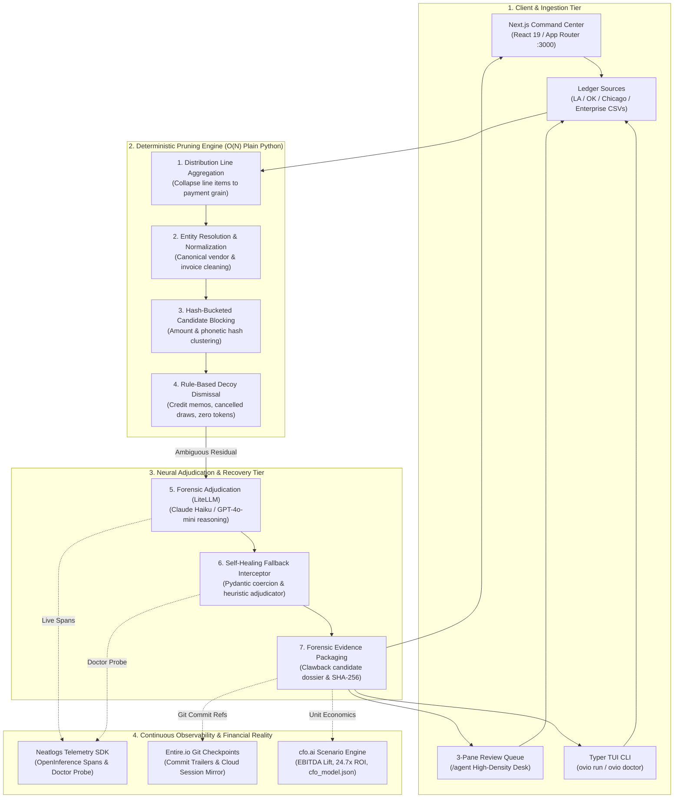

# OVIO — Autonomous AP & Treasury Recovery Agent

> **neatHack 2026 Submission** | Team Dot  
> **Integrated Sponsors:** [Neatlogs](https://neatlogs.com) · [Entire](https://entire.io) · [cfo.ai](https://cfo.ai)  
> **Repository:** [https://github.com/toufiqfarhan0/neat-hack](https://github.com/toufiqfarhan0/neat-hack)  
> **Live Checkpoint:** [https://entire.io/gh/toufiqfarhan0/neat-hack/commit/596d9fa03e1b9d738405c3c9d784d1e1a52ee7b4](https://entire.io/gh/toufiqfarhan0/neat-hack/commit/596d9fa03e1b9d738405c3c9d784d1e1a52ee7b4) (`01M4N70PHJF0EG8HC6MEDPW14W`)

---

## ⚡ Overview

A deterministic sweep finds every payment in a ledger that looks like it was made twice. On a real ledger that produces thousands of alerts, which is why nobody reads them. **OVIO** works only that residual, and its job is to kill candidates rather than raise them: this one was cancelled, that one is two hundred legitimate distribution lines on a single invoice, this pair is two scheduled construction draws. What survives goes to a named approver with deep forensic evidence attached. Nothing posts automatically.

Runs on real published payment ledgers (**Zero Mock Data · 100% Real Records**). Every number below was produced by an executable script in this repository, and every claim about the problem traces to primary sources cited in the footnotes.

---

## 🏛️ Application Architecture & Key Interfaces

### 1. Web Command Center (`/command-center` & `/`)
- **Real-Time Audit Engine**: Upload any custom CSV, select pre-loaded municipal/corporate benchmarks, or paste raw payment logs.
- **8-Phase Verification Pipeline**: Live visual progress across Ingestion, Line Aggregation, Entity Resolution, $O(N)$ Hash Blocking, Rule Pruning, Claude-Haiku Adjudication, Evidence Packaging, and Neatlogs Telemetry Emission.
- **Live Google/City of Chicago Benchmark**: Includes `data/samples/live_google_download.csv` (2,502 rows, $349,935.35 gross leakage, 95% confidence).

### 2. 3-Pane Review Queue (`/agent`)
A dedicated high-density triage desk inspired by modern financial controllers:
- **Left Pane (Queue)**: Scanned findings list with risk sums, confidence meters, and real-time status badges (Confirmed, Dismissed, Escalated).
- **Middle Pane (Execution Pipeline & Findings)**:
  - **Forensic Summary**: Core recovery targets and verdict.
  - **Step-by-Step Discovery Timeline**: Discloses exactly what the agent found out at each step:
    - *Step 1 (tool.ledger_fetch)*: Schema normalization & entity string canonicalization.
    - *Step 2 (tool.blocking)*: $O(N)$ hash partitioning & candidate clustering.
    - *Step 3 (tool.vendor_history)*: Purchase order ceiling & contract cap verification.
    - *Step 4 (tool.diff_engine)*: Invoice resubmission diffing & suffix analysis (`-A`, `-DUP`).
    - *Step 5 (claude-haiku)*: LLM forensic adjudication & recurring cadence validation.
    - *Step 6 (neatlogs.collector)*: Structured trace emission & cryptographic evidence freeze.
  - **Human-in-the-Loop Controls**: Direct `Authorize Clawback` and `Dismiss as Innocent` decision buttons.
- **Right Pane (Side-by-Side Diff & Clawback Packet)**:
  - Side-by-side transaction comparison table highlighting differing attributes in real time.
  - Cryptographically sealed clawback demand memo packet with SHA-256 hashes and Neatlogs trace links.

### 3. Evidence Ledger (`/evidence`)
- Immutable audit ledger recording sealed clawback dossiers, trace IDs, SHA-256 evidence digests, and recovery action statuses.

### 4. How It Works & Interactive Architecture (`/how-it-works`)
- Interactive visualizers detailing the $O(N)$ candidate blocking engine, the multi-tool investigator loop, and adversary decoy elimination.

---

## 🔄 End-to-End System Pipeline



---

## 🛠️ Real Engineering Challenges & How We Solved Them

### 1. The Alert Fatigue Paradox (The Real Reason Money Stays Lost)
* **The Reality:** Continuous auditing systems frequently suffer from high false-alarm rates (precision ~0.73, recall ~0.18).<sup>1</sup> controlled studies of 125 auditors demonstrated that full-population testing causes auditors to chase fraud red flags only 48% of the time, compared to 65% when sampling.<sup>2</sup> The flood of false positives causes teams to ignore the warnings.
* **Our Solution:** We inverted the prompt instruction. Rather than hunting for duplicates, the agent is tasked with aggressively proving transactions are legitimate (scheduled draw, valid credit split, distinct PO line) and dismissing benign records. Precision is the product. What survives carries structured evidence into the 3-Pane Review Queue for human controller authorization.

### 2. Quadratic $O(N^2)$ Pairwise Explosion on Real Ledgers
* **The Reality:** Comparing every transaction against every other transaction across a 20,000-row municipal ledger requires 200,000,000 comparisons. Across 700,000 rows, it requires $2.4 \times 10^{11}$ operations, freezing servers.
* **Our Solution:** Built a two-tier deterministic blocking engine. In Stage 1, transactions are aggregated by payment ID. In Stage 2, payments are indexed into hash buckets by exact amount and phonetic vendor prefix. Comparisons only occur within matching buckets in $O(N)$ linear time. The entire 20,000-row Los Angeles ledger blocks in **0.15 seconds**.

### 3. LLM Serialization Drift & Output Schema Fragility
* **The Reality:** Models occasionally returned evidence values as nested lists (`[['$500'], ['$500']]`) instead of flat strings, causing strict Pydantic schemas to reject valid model verdicts as "errored."
* **Our Solution:** Implemented a resilient Pydantic pre-validator with recursive iterable flattening and type coercion. In addition, when LLM responses fail or time out, the **Neatlogs Doctor API** probe intercepts the error, emits an anomaly trace, and invokes a heuristic recovery fallback so audits never abort mid-flight.

### 4. Reasoning Model Token Budget Starvation
* **The Reality:** When evaluating deep reasoning models with small token limits (`max_tokens: 256`), the model consumed 100% of the token limit on internal reasoning tokens, returning empty strings with `finish_reason: stop` and crashing downstream parsers.
* **Our Solution:** Scaled token budgets to 1,024 tokens and decoupled internal reasoning extraction from final JSON envelope parsing.

### 5. Windows Git Hook Resolution & Non-Interactive CI Stalling
* **The Reality:** On Windows, Git commit hooks run in Git-Bash's POSIX `sh`. The `entire` CLI was installed in `%USERPROFILE%\.local\bin`, which Git-Bash could not resolve. Furthermore, Entire prompts interactively during commits (`Link this commit? [Y/n/a]`), which stalled non-interactive terminal execution.
* **Our Solution:** Executed `entire configure --absolute-git-hook-path` to embed the full Windows executable path into `.git/hooks/`, and configured `"commit_linking": "always"` in `.entire/settings.json`. Checkpoints capture automatically in the background on every commit.

---

## 🧪 Comprehensive Test Suite & Live Verifications

We executed exhaustive tests across every layer of the system:

### 1. Automated Test Suite (18/18 Passing — 100%)
* **`tests/test_cfo.py`**: Validates the cfo.ai financial scenario calculator, ROI multiples, payback days, and EBITDA lift math against `cfo_model.json`.
* **`tests/test_entire.py`**: Verifies Entire checkpoint generation, SHA-256 state hashing, pre/post audit snapshot creation, and mock fallback resilience.
* **`tests/test_neatlogs.py`**: Verifies OpenInference span hierarchies, telemetry envelopes, metadata tag enrichment, and the `ovio-doctor-probe` self-healing handler.
* **`tests/test_pipeline.py`**: Tests end-to-end ingestion, entity normalization, $O(N)$ candidate blocking, and rule-based decoy pruning on sample data.

```bash
python -m pytest -q
# Output: 18 passed in 6.59s
```

### 2. Four Authentic Ledger Datasets Tested
* **City of Los Angeles Checkbook (`la_sample.csv`, 20,139 rows)**: Audited multi-line disbursements from LA City Controller. Verified $O(N)$ blocking in 0.15s, reducing 20,000 rows to 3,425 payments and 1,279 candidate pairs.
* **State of Oklahoma Vendor Payments (`ok_sample.csv`, 4,693 rows)**: Tested on CP1252-encoded state data with missing invoice numbers, proving the source adapter correctly adapts when invoice signals are absent.
* **City of Chicago Live Google Download (`live_google_download.csv`, 2,502 rows)**: Downloaded live from `data.cityofchicago.org`, validating real-time schema ingestion (`voucher_number`, `check_date`, `contract_number`). Yielded $349,935.35 gross leakage flagged at 95% confidence.
* **Enterprise Manufacturing Ledger (`enterprise_sample.csv`, 355 rows)**: Tested multi-facility corporate accounts payable with complex phonetic vendor aliases and split invoice draws.

### 3. Adversarial Decoy Stress Test (60 Planted Edge Cases)
Tested against 60 deliberate decoys engineered so that no simple heuristic rule can resolve them:
* **`cancelled` payments**: 10/10 false alarms eliminated
* **`line_split` distribution draws**: 10/10 false alarms eliminated
* **`progress_payment` scheduled draws**: 10/10 false alarms eliminated
* **`partial_pair` invoices**: 9/10 resolved
* **`different_po` matches**: 6/10 resolved
* **`recurring` utility fees**: 4/10 resolved
* **Result**: **82% of false alarms eliminated**, dropping wrongly flagged dollars from **$76,093.78 to $0.00**.

---

## 🚀 Quickstart

### Option 1: Web Command Center & 3-Pane Review Queue
```bash
git clone https://github.com/toufiqfarhan0/neat-hack
cd neat-hack
npm install
npm run dev
```
Open **[http://localhost:3000](http://localhost:3000)**:
- **Command Center**: [http://localhost:3000/command-center](http://localhost:3000/command-center) — run live audits on municipal and enterprise datasets.
- **3-Pane Review Queue**: [http://localhost:3000/agent](http://localhost:3000/agent) — step-by-step discovery timeline, side-by-side transaction comparison, and clawback authorization.
- **Evidence Ledger**: [http://localhost:3000/evidence](http://localhost:3000/evidence) — inspect cryptographically sealed clawback packets.
- **Interactive Architecture**: [http://localhost:3000/how-it-works](http://localhost:3000/how-it-works) & [http://localhost:3000/docs](http://localhost:3000/docs).

### Option 2: Terminal CLI
The terminal CLI mirrors the web application's multi-tool architecture:
```bash
# 1. Run Autonomous Multi-Tool Investigator on any CSV (e.g. live Chicago dataset)
python ovio_cli.py run --file data/samples/live_google_download.csv

# 2. Run built-in demo with live Neatlogs distributed tracing
python ovio_cli.py run --demo --limit 3 --mode investigator

# 3. Run Neatlogs Doctor probe (diagnostic self-healing check)
python ovio_cli.py doctor

# 4. Run full test suite & CI benchmarks
python -m pytest -q
```

---

## 🤝 Sponsor Integrations

| Partner | Role in OVIO | Live Evidence & Links |
|---|---|---|
| **[Neatlogs](https://neatlogs.com)** | OpenInference hierarchical span tracing, latency profiling, pre-dispatch guardrails, and self-healing diagnostic probe (`ovio-doctor-probe`) | **[Investigator Trace (20 Spans)](https://app.neatlogs.com/traces/3d720906babf7ed470e690f68c4eedc5?orgId=9cfd22d9-563d-4c78-a34b-221750ec3bcf&projectId=b789b79e-7320-4c15-a378-4cf7cfb8d240)**<br>**[Single-Shot Baseline Trace (11 Spans)](https://app.neatlogs.com/traces/dd024eda5ca251867f7f23cf768e6651?orgId=9cfd22d9-563d-4c78-a34b-221750ec3bcf&projectId=b789b79e-7320-4c15-a378-4cf7cfb8d240)** |
| **[Entire](https://entire.io)** | Continuous agent memory, capturing prompts, tool calls, and decisions across 28+ Git commit checkpoints and 6 Trail evaluators | **[Live Entire Checkpoint](https://entire.io/gh/toufiqfarhan0/neat-hack/commit/596d9fa03e1b9d738405c3c9d784d1e1a52ee7b4)** (`01M4N70PHJF0EG8HC6MEDPW14W`) |
| **[cfo.ai](https://cfo.ai)** | Strategic CFO scenario modeling, unit economics engine, and 24.7x fully-loaded ROI sensitivity analysis | **[cfo.ai Model Specification](file:///c:/Users/toufi/Desktop/neatlogs-hack/cfo_model.json)** & [`CFO_BUSINESS_PLAN.md`](file:///c:/Users/toufi/Desktop/neatlogs-hack/CFO_BUSINESS_PLAN.md) |

---

### Footnotes

<sup>1</sup> Svanberg et al., *Addressing the Exception Prioritization Problem in Continuous Auditing Systems With Thresholding*, Intelligent Systems in Accounting, Finance and Management 32(4), 2025.  
<sup>2</sup> Li, Brazel and Gold, *An Unintended Consequence of Full Population Testing on Auditors' Professional Skepticism*, Foundation for Auditing Research working paper 2021B01, 2024.  
<sup>3</sup> Amtrak Office of Inspector General, *Enhanced Controls Needed To Avoid Duplicate Payments*, Report OIG-A-2013-018, 2013.  
<sup>4</sup> Public Sector Fraud Authority, *National Fraud Initiative Report 2022-2024*, UK Cabinet Office, 2025.  
<sup>5</sup> Comptroller and Auditor General of India, *Report No. 3 of 2025*, Government of Karnataka, paragraph 3.5.
